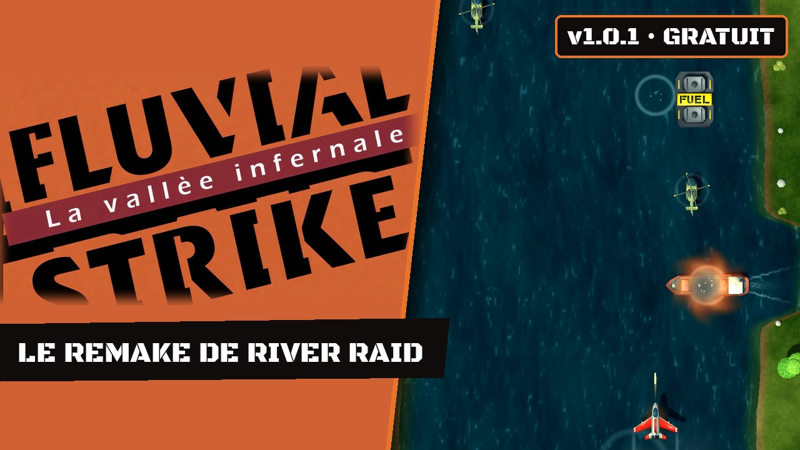
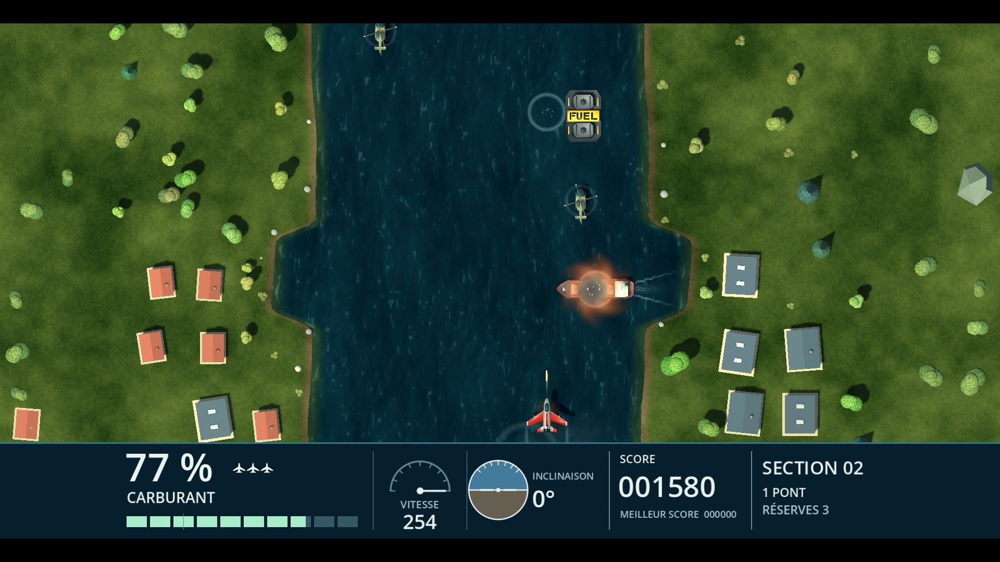
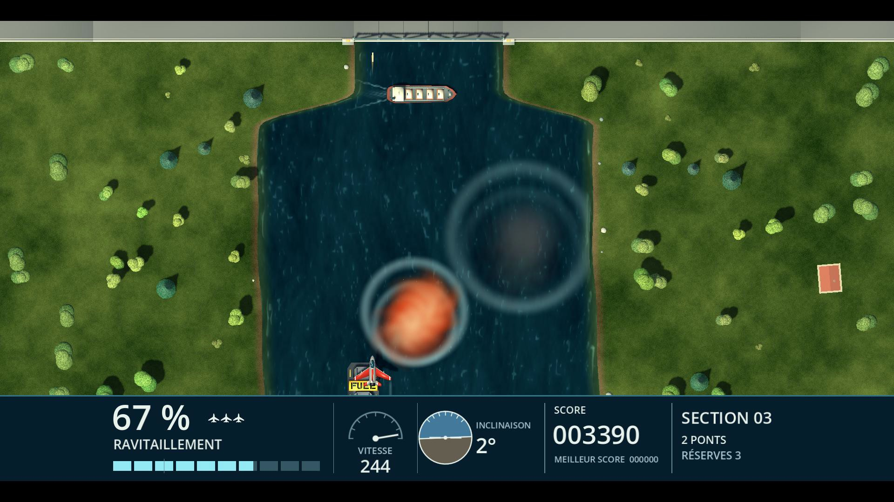
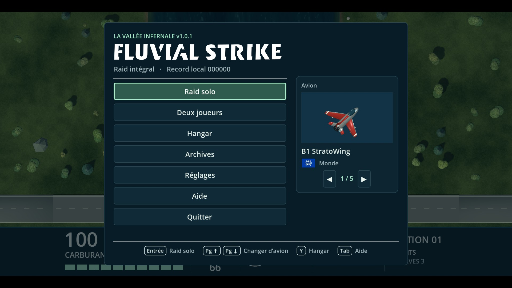

# Fluvial Strike

Jeu de tir en vue de dessus pour Windows. Pilote un jet au ras du fleuve, ravitaille-toi en vol et franchis les ponts. Le rendu 3D reprend un parcours de référence inspiré de *River Raid*, conçu par Carol Shaw et publié par Activision.

▶ [Voir le trailer sur YouTube](https://youtu.be/G1bnIrYPTO0)

| Combat | Ravitaillement en vol | Menu principal |
| --- | --- | --- |
|  |  |  |

## Jouer sous Windows

1. Télécharge le [ZIP Windows x64 de la version 1.0.1](https://github.com/Kraran/FluvialStrike/releases/download/v1.0.1/Fluvial-Strike-1.0.1-win64.zip).
2. Extrais l’archive et ouvre **Fluvial Strike.exe**. Garde le fichier `.pck` dans le même dossier.
3. Choisis **Jouer**. Les flèches ou le stick gauche pilotent le jet. **Espace** ou **A** tire. **Échap** ou **Start** ouvre la pause.

Le menu **Réglages** permet de modifier les commandes, le volume et l’affichage. **Affichage → Décor panoramique** prolonge les berges sur les écrans larges. Le jeu propose treize langues, deux difficultés (Novice et Expert) avec un classement local chacune, les replays du meilleur et du dernier raid, une aide inspirée du manuel d’origine et trois musiques d’ambiance. Le **Hangar** propose cinq avions au choix. En fin de raid, le bilan compare le score, la section atteinte et les ponts franchis aux records locaux. Depuis le bilan, **A** relance une partie et **B** revient au menu principal.

Le mode **Deux joueurs** se joue à tour de rôle après chaque vie perdue. Chaque pilote choisit son avion au premier tour et le garde pour la partie. Les deux joueurs peuvent partager le clavier, combiner clavier et manette ou utiliser deux manettes. Le jeu propose une attribution selon les manettes connectées, que tu peux modifier avant le départ.

## Ouvrir le projet

Installe [Godot 4.7.2 Standard](https://godotengine.org/download/archive/4.7.2-stable/), importe [Prototype/project.godot](Prototype/project.godot), puis lance le projet avec **F5** dans l’éditeur. Le [guide des sources](Prototype/README.md) décrit l’export Windows et les tests. La [fiche de référence](REFERENCE_GAMEPLAY.md) documente les mesures de gameplay.

Le projet est sous [licence MIT](LICENSE). Le ZIP inclut aussi la licence de Godot et les avis de ses composants.
